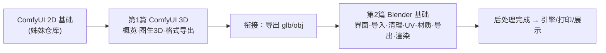

---
tags:
  - "#course/Blender"
  - "#type/资料"
created: 2026-11-18
---
# ComfyUI 3D 建模 + Blender 基础（3D Modeling Study Record）

一份**围绕「ComfyUI 生成 3D → Blender 后处理」这条主线**组织的笔记库。
两个主题（ComfyUI 3D 建模 / Blender 基础）**分篇存放、用相对超链互引**，避免互相耦合。

- GitHub：https://github.com/tliu154/Blender_study_record
- 本地：`D:\我的知识库\develop\Blender_study_record`（同时是 Obsidian 库子目录）
- 姊妹仓库：[ComfyUI 教学笔记](https://github.com/tliu154/ComfyUI_study_record) —— 2D 图像/视频主线，本仓库的第 1 篇会引用它的基础章节

## 定位与范围

- **第 1 篇 ComfyUI 3D 建模**：在 ComfyUI 里用 AI 生成 3D 模型（图生 3D / 文生 3D）、
  导出标准格式（glb/obj/ply），衔接 Blender。
- **第 2 篇 Blender 基础**：搭**完整 Blender 教学大纲**，但只把「ComfyUI 3D 后处理真正用得到」的
  章节写成正文（界面视图、导入检查、网格清理、UV/材质入门、导出、渲染出图）；
  其余（建模/灯光/骨骼/动画/雕刻等）留 `[待写]` 占位，按需再填。
- **超链解耦**：两篇之间、以及与 ComfyUI 主仓库之间，一律相对超链（GitHub 与 Obsidian 都能点开），
  不把对方的内容复制过来。

## 快速导航

| 文件 | 作用 |
|---|---|
| **[SYLLABUS.md](SYLLABUS.md)** | **完整骨架**：全局章号、每章状态、子概念索引、预定文件。**状态只在这里维护** |
| [CONTRIBUTING.md](CONTRIBUTING.md) | 命名、锚点、模板、标签、校验规范 |
| [NOTATION.md](NOTATION.md) | 术语与名词约定（ComfyUI / Blender 双语对照，见 [附录 A](90_appendix/docs/appA_glossary.md)）|
| [`_templates/`](_templates/) | 章节模板 / 实操任务模板 |
| [`tools/verify_all.py`](tools/verify_all.py) | 一键自检：相对链接 + 显式锚点 |
| [`tools/add_tags.py`](tools/add_tags.py) / [`tools/fix_links.py`](tools/fix_links.py) | 幂等打标签 / 失效链接一键修 |
| [`01_comfyui_3d/`](01_comfyui_3d/) | 第 1 篇 ComfyUI 3D 建模 |
| [`02_blender_basics/`](02_blender_basics/) | 第 2 篇 Blender 基础 |

## 学习依赖顺序



不严格按顺序 —— 每章开头用「前置」一行点明依赖，按需跳读。
文档是 Obsidian 库，章节之间用**相对 Markdown 超链**互引，便于 GitHub 也能点开。

## 目录结构

```
Blender_study_record/
├── README.md              本文件：导航、定位、路径图
├── SYLLABUS.md            完整章节骨架 + 状态（唯一状态源）
├── CONTRIBUTING.md        写作与校验规范
├── NOTATION.md            术语约定
├── _templates/            章节模板 / 实操任务模板
├── tools/                 verify_all.py / add_tags.py / fix_links.py
├── 01_comfyui_3d/         第1篇 ComfyUI 3D 建模
├── 02_blender_basics/     第2篇 Blender 基础
└── 90_appendix/           附录 A~C
```

每篇统一含 `README.md`（定位 + 依赖 + 实践方向）、`docs/`、`tasks/`。
章节清单不在篇 README 里重复，一律看 [SYLLABUS.md](SYLLABUS.md)。

## 单章模板（每节四段 + 实操）

```
概念定义 → 直觉类比 → 界面/参数 → 常见误区 → 对应实操链接
```

外加「和已有认知的差异 / 够用边界」——符号第一次出现配读法与人话解释，
每个主题标清「学到哪就够、什么可跳过」，不堆大段原理推导。
这是给想快速上手的学习者用的，不是从头啃到尾的教材。

## 实操任务

每章一份 `tasks/chNN_task.md`，是可照着做的上手任务：目标、前提、步骤、
验收标准、可复现参数、以及「改一改会怎样」的小实验。
部分章节（尤其 Blender 的 3D 后处理）重在看懂流程，任务分 A/B 档：
A 档真跑，B 档跑不动时看懂结构。

## 进度

- **已完成**：
  - 框架（本文件 + SYLLABUS + CONTRIBUTING + NOTATION + 模板 + 自检脚本 + 各篇 README）
  - 第 1 篇 ComfyUI 3D 建模：5 章教学 + 5 份实操（[ch01 概览](01_comfyui_3d/docs/ch01_3d_overview.md) / [ch02 图生 3D](01_comfyui_3d/docs/ch02_img2img3d.md) / [ch03 文生 3D](01_comfyui_3d/docs/ch03_text2_3d.md) / [ch04 格式导出](01_comfyui_3d/docs/ch04_formats.md) / [ch05 衔接 Blender](01_comfyui_3d/docs/ch05_handoff.md)）
- **进行中**：第 2 篇 Blender 基础（正文 = 3D 后处理用到的章节，其余占位），状态见 [SYLLABUS.md](SYLLABUS.md)

## 填充一章的最短路径

1. 在 [SYLLABUS.md](SYLLABUS.md) 找到章号 → 确认预定文件名
2. 复制 `_templates/chapter_template.md` 到对应篇的 `docs/chNN_*.md`
3. 复制 `_templates/task_template.md` 到对应篇的 `tasks/chNN_task.md`
4. 按模板逐节填写（每节显式锚点），章内概念索引链到锚点
5. 跑 `python tools/verify_all.py`、更新 SYLLABUS 状态、commit

详细规则见 [CONTRIBUTING.md](CONTRIBUTING.md)。
